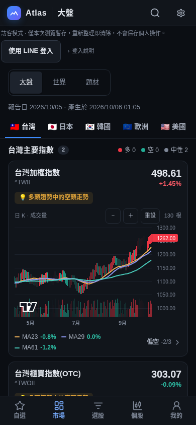
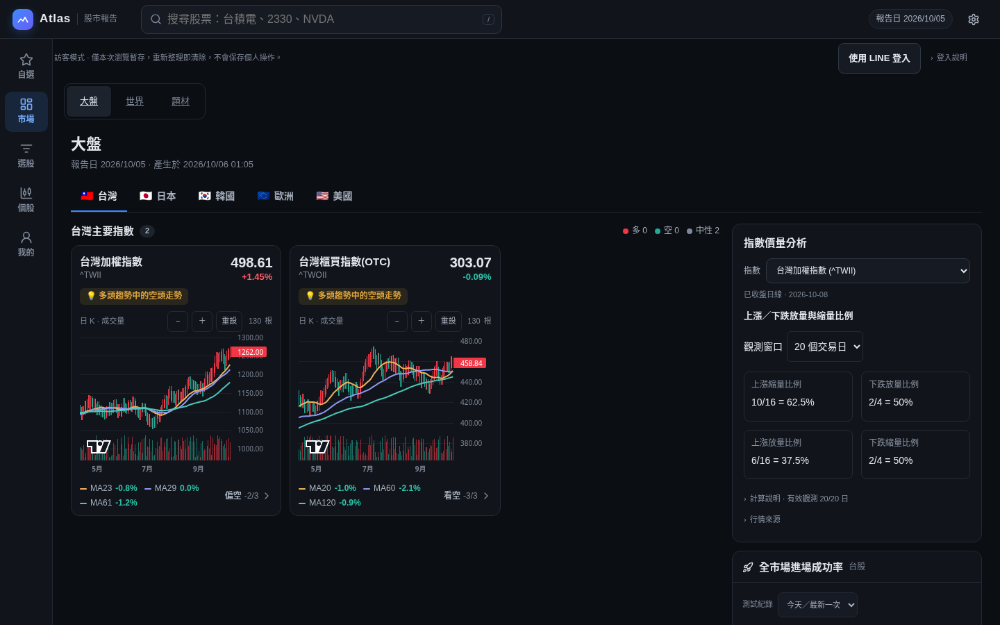

# Atlas 導覽改版第一階段

基準：main `d59b07be4`。本階段只搬移入口與既有內容，不改首頁預設、資料、帳號授權、伺服器或圖表引擎。

## 功能搬移清單

| 原功能／控制 | 改版後入口與保留方式 |
| --- | --- |
| 大盤；台灣／日本／韓國／歐洲／美國 | 主導覽「市場」→「大盤」；原市場選擇器與網址不變，跨區返回保留上次市場 |
| 指數圖、價量、突破成功率、市場寬度、LINE 摘要 | 原大盤頁完整保留，沒有改動 MarketsPage |
| 世界：美債利率、指數、原物料、匯率 | 「市場」→「世界」→原四個頁面按鈕；返回保留上次 view |
| 世界各比較區間、排序、圖表、來源與研究控制 | 原頁完整保留，沒有改動 WorldPage |
| 題材美股／台股、清單、熱力圖、題材明細與成分股 | 「市場」→「題材」；原控制與深連結保留，返回保留 market/v，明細仍使用 theme |
| 題材輪動、期間、相對報酬、產業篩選、研究圖表 | 原頁完整保留，沒有改動 ThemesPage |
| 選股群組、全市場、LINE 熱門、搜尋、排序、篩選、儲存策略 | 主導覽「選股」；既有控制不變，保存清單後前往自選清單 |
| 圖表工作台、股票切換、K 線週期、更新、指標、繪圖、提醒、回測、設定 | 主導覽「個股」；只改主導覽標籤，圖表頁標題與所有工作台功能不變 |
| 財務、季度／年度、估值、同業比較及 K 線往返 | 個股的「財務」入口與 financials 深連結不變；主導覽亮「個股」 |
| 手機底部「搜尋」 | 搬到非圖表頁頂部 44×44「搜尋股票」；手機圖表維持原精簡頂列與「切換股票」搜尋入口，兩者開啟同一搜尋 sheet |
| 桌面 SymbolSearch、`/`、最近搜尋與鍵盤選取 | 原位置及行為保留；ChartPage 的 onOpenSearch 仍開啟原搜尋 sheet |
| 控制台的自選清單分頁 | 主導覽「自選」→ `?page=watchlist`，原清單邏輯及控制原樣共用 |
| 以篩選建立、手動建立、選取、重新命名、刪除、匯入、匯出清單 | 自選清單頁完整保留；list UUID 仍決定選取清單 |
| 每日歷史、上次比較、新入選／出榜、連續天數、失敗保留基準 | 自選清單頁；同一份原有計算與儲存邏輯 |
| 清單雲端載入、匯入、刪除、自動同步及重試 | 自選清單頁；原驗證、版本、權限與錯誤處理不變 |
| 突破監控開關、監控均線、個股固定均線參數、SEC 雷達 | 自選清單頁；原控制與面板完整保留 |
| 均線參數、分組、個股參數、指數設定、LINE 入口 | 「我的」→「均線參數」；重用 ParameterConsole，原 LIFF 連結不變 |
| 管理員儲存權限設定 | 「我的」→「管理員」；仍僅顯示給原有已驗證管理員，重用 StorageAdminPanel |
| 顏色切換、安裝 Atlas、版本更新、報告日期／產生時間、說明 | 「我的」→「顯示與App」及原齒輪「顯示設定」皆使用同一 DisplaySettings 元件 |
| 原齒輪按鈕與對話框 | 保留原按鈕、開關方式與對話框；內容抽出共用，並未取消對話框 |
| StorageNotice 與 LINE 登入 | 保留 Site main 最上方原位置與原授權／登入流程 |
| StorageModeNotice、LegacyImportCard | 自選清單及我的皆保留；原授權規則不變 |
| 品牌首頁連結、預設落點、報告日期 chip、DataHealthPanel | 原位置、網址、邏輯保留；主導覽不改預設首頁 |
| RouteBoundary、lazy loading、chartVisited、捲動回頂 | 原機制保留；圖表離頁後仍保留掛載，財務往返檢查同一 chart DOM |

## 舊網址

| 輸入 | canonical／結果 |
| --- | --- |
| `?page=console&list=<uuid>` | `?page=watchlist&list=<uuid>`；選取同一清單 |
| `?page=watchlists[&list=<uuid>]` | `?page=watchlist[&list=<uuid>]` |
| `?page=watchlist[&list=<uuid>]` | 原樣，開啟自選清單 |
| `?page=settings` | `?page=console`（我的） |
| `?page=console` | 原樣，開啟我的，預設均線參數 |
| `?page=markets&market=tw/jp/kr/eu/us` | 原樣；`market` 等既有 alias 仍按原規則 canonicalize |
| `?page=world[&view=indices/commodities/fx]` | 原樣；利率仍為 world 預設 |
| `?page=rates`、`?page=bonds`、`?page=world&view=rates` | 仍 canonicalize 為 `?page=world` |
| `?page=themes[&market=tw][&v=map][&theme=<key>]` | 原樣；theme 等原 alias 與參數順序沿用原規則 |
| `?page=screener[&group=<key>][&f=<filters>]` | 原樣 |
| `?page=chart[&symbol=<symbol>][&tf=<tf>]` | 原樣 |
| `?page=financials[&symbol=<symbol>][&tf=<tf>][&p=q/a]` | 原樣 |
| 舊 `?symbol=<symbol>&tf=<tf>`／`timeframe=` | 仍轉到同一 chart route |
| 以上各網址包在 `liff.state`（query、path+query、雙重編碼） | 保留原解包流程，然後套用相同 canonicalize |

原 main.py SETTING_LIFF_URL 與 ParameterConsole LIFF 網址未修改，仍有效。

`document.title` 只有新自選頁使用「自選清單 — Atlas 股市報告」、console 從「參數控制台」改成「我的 — Atlas 股市報告」；其他頁及個股／財報代號標題格式不變。

## 測試調整與畫面證據

新測試：`tests/nav-routes-inventory.test.ts` 為逐網址及 LIFF 包裝的 parse/serialize/rewrite 表；`e2e-site/nav-inventory.spec.ts` 從五入口逐項操作所有原功能，檢查手機 320/390px、safe area、44px 點擊區、12px 標籤及無橫向溢位。

| 修改的既有 spec／helper | 原因（原功能斷言保留） |
| --- | --- |
| `account-privacy.spec.ts` | 圖表／控制台主導覽標籤改成個股／我的；清單改名測試前往 watchlist |
| `legacy-import.spec.ts` | 主導覽改名；原匯入、衝突、權限、重跑斷言保留 |
| `pwa-login.spec.ts` | 登入後前往圖表改點個股；其餘登入、隔離與登出斷言不變 |
| `navigation-recovery.spec.ts` | 世界／題材改走市場子導覽；保留 cold lazy、失敗 bundle、reload 與恢復斷言 |
| `site.spec.ts` | 手機搜尋改點頂部按鈕；精簡圖表頁走原股票切換入口，仍驗證相同搜尋結果 |
| `themes.spec.ts` | 主導覽數量由需求指定的 7 改成 5；仍檢查同列與每項至少 44px 寬 |
| `workspace-refinements.spec.ts` | 底列大盤入口改名市場；原圖表高度、面板可達性斷言不變 |
| `screener-universe-full.spec.ts` | 全量執行發現 main 既有測試在範圍說明收合時檢查其內文；先點原展開按鈕，保留全部原文字、狀態、數量及效能斷言，並增加美股展開狀態檢查；不改產品行為 |
| `e2e/drawing-picker.spec.ts` | 手機圖表的搜尋改從原股票切換按鈕開啟同一 sheet，原 Escape／焦點斷言保留 |
| `e2e/site-helpers.ts` | 搜尋 helper 跟隨搬移後的入口；工作台操作、資料源與匯出 helper 行為不變 |

`line-handoff.spec.ts`、`unified-console.spec.ts` 沒有刪改；其完整測試同樣執行。沒有透過修改 workflow 排除測試。

圖片以本地 headless Chromium、合成報告 fixture 拍攝，不代表正式行情或實體裝置驗收。完整瀏覽器測試也在 mobile-chromium 與 iphone-webkit 執行。入口測試另會產生 `navigation-mobile-390.png`、`navigation-desktop.png`、`my-display-mobile-390.png`、`my-display-desktop.png`；失敗時保留 Playwright trace，可用 `npx playwright show-trace <trace.zip>` 檢視。

實際命令與精確 pass/fail/skip 結果記錄在本次 PR body。完整 `npm run test:site` 不只執行新 inventory，也包含所有既有 spec。
